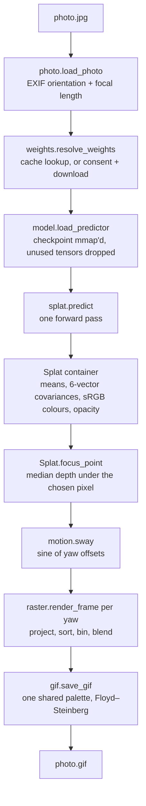

## The shape of it

One photo goes in; a looping GIF comes out. In between, the pipeline crosses a hard boundary: **torch does the thinking once, numba does the drawing forty-eight times.** Everything else is plumbing around that split — a photo reader that recovers the camera the picture came from, a weights fetcher that respects Apple's licence, a GIF writer that fights the 256-colour limit.

Measured on this box (i5-4570, CPU-only, 1280-px job): predict 121 s, render 19 s, peak RSS 6.08 GB, product 8.5 MB / 48 frames.



Nine modules, one direction of dependency: `cli → pipeline → {photo, splat, gif}`, `splat → {model, motion, weights}`, `raster → splat` (type-only at runtime). No module reaches "up".

## Keeping the imports honest

The CLI parses arguments without touching torch or numba: `main()` imports `pipeline` inside its body, and `Splat.render` imports `raster` inside its body (numba compiles on first touch). `splatgif --help` is therefore instant even though the "heavy" modules exist. `numba` kernels use `cache=True`, so the compile cost is paid once per machine, not once per run.

## photo.py — the camera that made the picture

A single photo is only interpretable in 3D if you know the lens. `load_photo` returns upright RGB pixels plus a focal length in pixels:

- EXIF orientation is applied (`exif_transpose`) before anything reads the pixels, so a rotated phone JPEG never becomes a rotated splat.
- Focal length comes from `FocalLengthIn35mmFilm` when present, else `FocalLength`. A real focal length under 10 mm means a small sensor, so it's converted by the crude factor Apple's tooling uses (×8.4).
- No focal information at all → 35 mm-equivalent 30 mm is assumed, and `GifInfo.exif_focal` records the guess. With no real focal length, depth is only known up to scale; the render is still self-consistent because scale and distance are derived from the same assumed `f`.
- Focal in pixels is computed against the frame diagonal: `f_35mm × hypot(W, H) / hypot(36, 24)`.

HEIC support is a soft dependency: the format handler is imported lazily, and a clean error points at `pip install 'splatgif[heic]'`.

## weights.py — consent before download

The 2.8 GB SHARP checkpoint is not in the package and cannot be: Apple licenses it for non-commercial research only, under revocable terms. Resolution order:

1. explicit `--weights` / `SPLATGIF_WEIGHTS` path (must exist — no silent fallback),
2. the `torch.hub` cache (the same directory Apple's own CLI uses, so a download done there is reused here),
3. a download that first demands consent — a y/N prompt on a TTY, otherwise it refuses unless `--accept-license` / `SPLATGIF_ACCEPT_LICENSE=1` was passed explicitly. Scripts never get consent by accident.

The download is SHA-256 verified against the checksum pinned in the module. The licence text itself ships in `licenses/` so the terms travel with the code.

## model.py — SHARP, condensed to inference

A from-scratch re-implementation of only what the released checkpoint needs, kept deliberately small and deliberately name-identical to the checkpoint so it loads `strict=True`:

- **Input:** the photo resampled to 1536×1536. Network is a Depth Pro-style sliding pyramid — 25 + 9 + 1 overlapping 384-px tiles through one DINOv2-L/16 ViT (written out here rather than importing `timm`, and thereby torchvision).
- **Depth:** the ViT feeds a DPT-style decoder that fuses a five-level feature pyramid coarse-to-fine and emits two-channel disparity at full resolution. Depth is converted by `depth = (f_px / width) / disparity` — the photo's real focal length enters here, which is why photo.py matters.
- **Gaussians:** roughly 1.18 M of them, on a stride-2 grid, two layers deep. The network predicts *deltas* from a base parametrisation (NDC positions, depth-proportional scales, identity rotations, the photo's own colours, 0.5 opacity), so a zero-delta output reproduces the photograph as flat paper at scene scale.
- **Pruning:** the depth-alignment UNet and ViT classifier heads are never instantiated; their checkpoint tensors are dropped by regex before loading.
- **No quaternion round-trip:** the camera-space conversion (next section) consumes covariance directly.

`load_predictor` memory-maps the checkpoint, so the 2.8 GB file is not copied into RAM, and everything runs under `inference_mode()`.

## splat.py — the scene and its two jobs

`predict()` ends in camera space: undo the NDC parametrisation with a diagonal map `diag(W/2f, H/2f, 1)`, build covariance from `R·diag(scales)` without ever touching quaternions (Apple's SVD re-derivation gives the same result; this is shorter), and drop any Gaussian with opacity below one 8-bit level — typically leaving ~1.18 M of the maximum. Colours stay sRGB end to end; see the rasteriser note.

The `Splat` dataclass is the whole interface between the two halves: 11 floats' worth of fields plus arrays, no behaviour from torch. That boundary is what lets the render half run with no model loaded, and lets tests hand-build scenes.

`focus_point` picks the pivot: the median depth of the Gaussians projecting into a 10 % window around the chosen pixel (default: the frame centre). Fewer than 500 samples there means the window is probably empty sky or a miss, so it falls back to the median depth of the whole scene.

## motion.py + raster.py — the small CPU renderer

`sway` is one line: a sine of yaw offsets that starts at 0 (frame 0 *is* the photograph) and never duplicates its first frame at the end, because a GIF returns to frame 0 on its own and a duplicate would hitch the loop. Presets: moderate ±2.5° (a touch more than a real Nishika camera, which reads as mush on screen), drastic ±8° — still inside the cone one photo can support.

`render_frame` swings the camera about the pivot (rotation plus `pivot − R·pivot` translation keeps the pivot fixed on screen) and runs three compiled kernels:

| Kernel | Work | Parallelism |
|---|---|---|
| `_project` | transform each Gaussian into camera space, cull behind the near plane, EWA-project the 3D covariance to a 2D ellipse through the pinhole Jacobian, compute the pixel bounding box | one Gaussian per thread |
| `_bin` | counting-sort Gaussians into 16×16-tile lists, nearest-first, in `n_chunks` disjoint slices | one chunk per thread |
| `_blend` | front-to-back alpha blending, one tile per task, writing uint8 directly | one tile per thread |

The cheap tricks are the product. Projection computes how far out a Gaussian still adds at least one 8-bit level (`k = √(2·ln(255·o))`) and declares everything beyond it a bounding-box miss. Blending reads that cutoff and skips the `exp` entirely below it; it ends a pixel early once transmitted light drops under 1/10000, and stops a tile entirely when no pixel still accepts colour. The low-pass filter is 0.075 px² added to the covariance diagonal — stock 3DGS uses 0.3, which smears SHARP's small splats; 0.075 kept the photograph's sharpness while still taming the sub-pixel speckle thin foliage produces.

Blending happens in **sRGB**, the way public splat viewers (and the browser pipeline this replaced) do it, not in linear light as Apple's own renderer does. The two differ by a few 8-bit levels where Gaussians only partly cover a pixel; sRGB measured slightly *better* on the foliage-speckle test. Documented here because it will look like a bug to anyone comparing against Apple's output.

## gif.py — negotiating with 256 colours

GIF allows one palette where the render wants millions of colours. Two deliberate choices:

- **One palette for the whole loop**, built from ~300k pixels sampled across *all* frames. Per-frame palettes make colours crawl frame to frame; a frame-0-only palette misses colours that exist only mid-sway. libimagequant when Pillow has it, median-cut otherwise.
- **Floyd–Steinberg dithering** by default trades banding on smooth gradients (sky) for fine grain; `--no-dither` takes the smaller file instead.

Frame delay is rounded to GIF's 10 ms grid, and the loop is infinite by construction (`loop=0`).

## CLI and API

`cli.py` is argument checking and nothing else — devices, motion presets or explicit degrees (0–45], focus fractions, sizes — then one call to `pipeline.make_gif`. Exit code 1 with a one-line message on user-facing errors (missing file, declined licence, bad weights); the GIF path goes to stdout so `splatgif photo.jpg | xdg-open -` style chaining works.

The library API is the same entry point: `make_gif` returns a `GifInfo` with everything a watcher would want to log — dimensions, frame count, bytes, focal length and whether it was guessed, pivot depth, Gaussian count, device, and the time split between predict and render.

## Deliberately not in here

- **No CUDA / GPU renderer.** torch uses whatever device exists, but the rasteriser is CPU by design; a GPU path would reintroduce the compiler-at-install problem.
- **No PLY export.** The covariance representation would support it, but the product is the GIF.
- **No multi-photo scenes.** One photo, one splat, one loop.
- **No video input, no batch mode.** A watcher can shell-loop the CLI; the in-image API covers the scripted case.

## Packaging posture

The wheel ships code only (~30 KB), and dependencies stop at torch, NumPy, Pillow, numba — no timm, no torchvision, no scipy. The licence line is `MIT AND LicenseRef-Apple-ML-SHARP`: the code is MIT, the *weights* are Apple's research-only terms and are fetched separately behind consent. That split is a design decision with marketing consequences — users can make GIFs freely, but anything commercial must clear Apple's licence for the model.

Two commits' worth of evidence that this is tested, not aspirational: `tests/sharp_params.txt.gz` pins the checkpoint's parameter names so a checkpoint drift fails CI, and `test_matches_apple.py` compares module output against Apple's own reference code path.

## Repo map

```
pyproject.toml            hatchling build; license expression; splatgif[heic] extra
LICENSE, licenses/*       MIT + both Apple licence files (ship in wheel and sdist)
src/splatgif/             nine modules as above; py.typed marks it typed
tests/                    fast tests run without weights; anything needing
                          the 2.8 GB checkpoint is marked slow and deselected
```

Everything above describes what is in the tree at v0.1.0, not what could be added later.