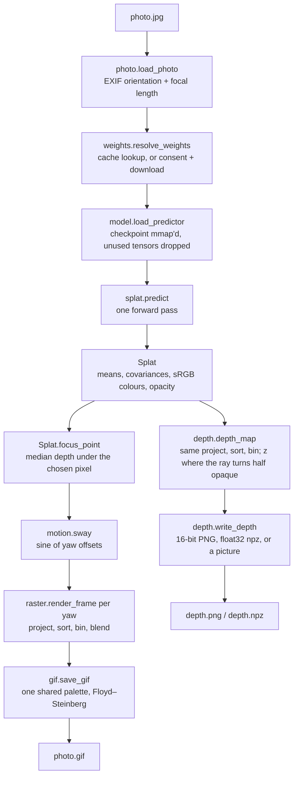

## The shape of it

One photo goes in; a looping GIF or a depth map comes out. In between, the pipeline crosses a hard boundary: **torch does the thinking once, numba does the drawing and measuring.** Everything else is plumbing around that split: a photo reader that recovers the camera the picture came from, a weights fetcher that respects Apple's licence, a GIF writer that fights the 256-colour limit.

Measured on this box (i5-4570, CPU only, 4 cores, 16 GB): the network pass takes about 90 to 120 s and peaks near 6.1 GB. Drawing a 48-frame GIF takes about 19 s at 640 px (8.5 MB) and about 32 s at 1280 px (35 to 40 MB). A 1280 px depth map takes under a second.



Ten modules, one direction of dependency:

- `cli → pipeline`, and `pipeline → photo, splat, gif` (plus `depth`, imported inside `make_depth`).
- `splat → model, motion, weights, photo`, and, imported inside the methods that need them, `splat → raster` (`render`) and `splat → depth` (`depth_map`).
- `depth → raster, motion`: it reuses the rasteriser's projection and tile-binning kernels.
- `raster → splat` is type-only, so nothing imports upward at runtime.

## Keeping the imports honest

The CLI parses arguments without touching torch or numba: `main()` imports `pipeline` inside its body, and the methods that need numba (`Splat.render`, `Splat.depth_map`, `make_depth`) import `raster` and `depth` inside theirs. `splatgif --help` is therefore instant even though the heavy modules exist, and a test asserts that `torch` is not in `sys.modules` after the parser is built. The numba kernels use `cache=True`, so the compile cost is paid once per machine, not once per run.

## photo.py — the camera that made the picture

A single photo is only interpretable in 3D if you know the lens. `load_photo` returns upright RGB pixels plus a focal length in pixels:

- EXIF orientation is applied (`exif_transpose`) before anything reads the pixels, so a rotated phone JPEG never becomes a rotated splat.
- Focal length comes from `FocalLengthIn35mmFilm` when present, else `FocalLength`; a real focal length under 10 mm means a small sensor and is converted with the crude ×8.4 factor, mirroring Apple's loader.
- No focal information at all (typical for photos that came through a chat app) → a 30 mm 35 mm-equivalent lens is assumed and `exif_focal` records the guess. Frame 0 still matches the photograph; only the metric scale of the scene is a guess.
- Focal length in pixels is computed against the frame diagonal: `f_35mm × hypot(W, H) / hypot(36, 24)`.

HEIC support is a soft dependency: the format handler is imported lazily, and a clean error points at `pip install 'splatgif[heic]'`.

## weights.py — consent before download

The 2.8 GB SHARP checkpoint is not in the package and cannot be: Apple licenses it for non-commercial research only, under revocable terms. Resolution order:

1. explicit `--weights` / `SPLATGIF_WEIGHTS` path (must exist, no silent fallback),
2. the `torch.hub` cache (the same directory Apple's own CLI uses, so a download done there is reused here),
3. a download that first demands consent: a y/N prompt on a TTY, otherwise it refuses unless `--accept-license` / `SPLATGIF_ACCEPT_LICENSE=1` was passed. Scripts never get consent by accident.

The download is SHA-256 verified against the checksum pinned in the module. The licence text itself ships in `licenses/` so the terms travel with the code.

## model.py — SHARP, condensed to inference

A re-implementation of only what the released checkpoint needs, kept name-identical to the checkpoint so it loads `strict=True`:

- **Input:** the photo resampled to 1536×1536. The encoder is a Depth Pro-style sliding pyramid: 25 + 9 + 1 overlapping 384-px tiles through one DINOv2-L/16 ViT (written out here rather than importing `timm`, and with it torchvision), plus a second ViT for the low-resolution view.
- **Depth:** the ViT features feed a DPT-style decoder that fuses a five-level pyramid coarse to fine and emits two-channel disparity at full resolution. Depth is `(f_px / width) / disparity`: the photo's real focal length enters here, which is why `photo.py` matters, and why the output is metric (Depth Pro lineage) rather than an arbitrary scale.
- **Gaussians:** about 1.18 M of them, on a stride-2 grid, two layers deep. The network predicts *deltas* from a base parametrisation (positions from the predicted depth, depth-proportional scales, identity rotations, the photo's own colours, 0.5 opacity), so a zero-delta output would already be a coloured two-layer depth surface of the photograph.
- **Pruning:** the depth-alignment UNet and ViT classifier heads are never instantiated; their checkpoint tensors are dropped by regex before loading.

`load_predictor` memory-maps the checkpoint, so the 2.8 GB file is not copied into RAM, and everything runs under `inference_mode()`.

## splat.py — the scene and its jobs

`predict()` ends in camera space. `to_camera_space` undoes the NDC parametrisation with a diagonal map `diag(W/2f, H/2f, 1)` and builds each covariance directly from the predicted rotation and scales (`Σ = M Mᵀ`, with `M = D·R·diag(s)`). Apple instead re-derives a quaternion with an SVD; applying the map to the covariance gives the same Gaussians with less code. Any Gaussian with opacity below one 8-bit level is dropped, which leaves about 1.18 M of the 1,179,648 maximum. Colours stay sRGB end to end; see the rasteriser note.

The `Splat` dataclass is the whole interface between the two halves: four NumPy arrays (13 floats per Gaussian: mean 3, covariance 6, colour 3, opacity 1) plus the photo's focal length and size. That boundary is what lets the render half run with no model loaded, and lets tests hand-build scenes.

Two methods consume it. `render` draws the sway, and `depth_map` measures. `focus_point` picks the pivot for the first: the median depth of the Gaussians projecting into a 10 % window around the chosen pixel (default: the frame centre). Fewer than 500 samples there means the window is probably empty sky or a miss, so it falls back to the median depth of the whole scene.

## motion.py + raster.py — the small CPU renderer

`sway` is one line: a sine of yaw offsets that starts at 0 (frame 0 *is* the photograph) and never duplicates its first frame at the end, because a GIF returns to frame 0 on its own and a duplicate would hitch the loop. Presets: moderate ±2.5° (a little more than a real Nishika camera, which reads as mush on a screen) and drastic ±8°, still inside the cone one photo can support.

`render_frame` swings the camera about the pivot (a rotation plus a `pivot − R·pivot` translation keeps the pivot fixed on screen) and runs three compiled kernels:

| Kernel | Work | Parallelism |
|---|---|---|
| `_project` | transform each Gaussian into camera space, cull behind the near plane, EWA-project the 3D covariance to a 2D ellipse through the pinhole Jacobian, compute the pixel bounding box | one Gaussian per thread |
| `_bin` | counting-sort Gaussians into 16×16-tile lists, nearest first, in disjoint slices | one slice per thread |
| `_blend` | front-to-back alpha blending, one tile per task, writing uint8 directly | one tile per thread |

The cheap tricks are the product. Projection computes how far out a Gaussian still adds at least one 8-bit level (`k = √(2·ln(255·o))`) and treats everything beyond it as a bounding-box miss. Blending reads that cutoff and skips the `exp` below it, ends a pixel early once transmitted light drops under 1/10000, and stops a tile when no pixel still accepts colour. The low-pass filter is 0.075 px² added to the covariance diagonal; stock 3DGS uses 0.3, which smears SHARP's small splats, while 0.075 kept the photograph's sharpness and still tamed the sub-pixel speckle thin foliage produces.

Blending happens in **sRGB**, the way public splat viewers do it, not in linear light as Apple's own renderer does. The two differ by a few 8-bit levels where Gaussians only partly cover a pixel, and sRGB showed slightly less foliage speckle in testing. It is documented here because it will look like a bug to anyone comparing against Apple's output.

## depth.py — the same walk, a different accumulator

A depth map needs no new geometry. `depth_map` calls the rasteriser's own `_project` and `_bin` at the photo's identity pose, then runs a third kernel, `_depth_pass`, over the same nearest-first tile lists with the same alpha maths as `_blend`. Instead of summing colour it watches opacity build up along each pixel's ray and keeps the camera-space z of the Gaussian that carries it past one half: the **median depth of the ray**.

Two simpler rules were rejected, and a test pins each:

- **First Gaussian within the 1/255 cutoff** would paint a near object's depth about 3σ beyond its visible edge, a halo of several pixels.
- **An opacity-weighted average** would smear near and far together at every silhouette, producing depths that belong to nothing.

Median depth follows what the photograph shows (frame 0 blends the same Gaussians in the same order) and stays sharp at silhouettes: across 612 strong depth steps on a test portrait the median 10 to 90 % transition was 3 px at 1280. A pixel the Gaussians never make half opaque is empty (NaN, or 0 in a 16-bit file). Each pixel is written only by its own tile's task, so there is nothing to race on and the answer cannot depend on thread or tile order.

The values are **z-depth in metres, if the lens was right**: the network is metric, but the scale is only as good as the focal length. `DepthMap` carries `f_px` (for the map's own pixel grid, so a pixel unprojects to a camera-space point) and `exif_focal`, which is False for photos without lens data, where the metres are approximate.

Files are chosen by suffix. `.npz` is lossless float32. `.png` and `.tif` are 16-bit grayscale in the KITTI convention (metres × 256, 0 = empty, 0.004 m steps, saturating at 255.99 m), and a PNG carries `f_px` and `exif_focal` in a text chunk so `load_depth` can restore them. `--depth-cmap`, or any other suffix, writes a picture for eyes (red near, violet far, scaled per image over inverse depth) that cannot be loaded back.

**Known limit:** SHARP pulls its outermost Gaussians toward the camera, so every map has a band about 30 px wide at 1280 px that reads nearer than the scene it frames. On a test portrait the wall was 1.5 to 1.9 m away while 95 % of the Gaussians within 32 px of the frame edge sat nearer than 0.7 m. The Gaussians show it before any depth logic runs, and a brute-force per-pixel reference (400 pixels per photo, no mismatches) shows the depth pass reports exactly what they say.

## gif.py — negotiating with 256 colours

GIF allows one palette where the render wants millions of colours. Two deliberate choices:

- **One palette for the whole loop**, built from about 300k pixels sampled across *all* frames. Per-frame palettes make colours crawl from frame to frame; a frame-0-only palette misses colours that appear only mid-sway. libimagequant is used when Pillow has it, median cut otherwise.
- **Floyd–Steinberg dithering** by default trades banding on smooth gradients (sky) for fine grain; `--no-dither` takes the smaller file instead.

Frame delay is rounded to GIF's 10 ms grid, and the loop is infinite by construction (`loop=0`).

## CLI and API

`cli.py` is argument checking and nothing else: devices, motion presets or an explicit angle in degrees (0 to 45), focus fractions, sizes. Then it makes one call to `pipeline.make_gif`, or to `pipeline.make_depth` when `--depth FILE` is given (contradictory flags such as `--depth` with `-o` are refused up front). User-facing errors (missing file, declined licence, bad weights, a depth file with the wrong suffix) exit 1 with a one-line message, and the output path goes to stdout so it composes in a shell: `xdg-open "$(splatgif photo.jpg)"`.

The library API is the same pair of entry points. `make_gif` returns a `GifInfo` and `make_depth` a `DepthInfo`; each carries what a watcher would want to log: dimensions, bytes, focal length and whether it was guessed, Gaussian count, device, and the time split between prediction and the final stage. To get both a GIF and a depth map from one photo without predicting twice, call `predict` once and use `Splat.render` and `Splat.depth_map` on the result.

## What is not here

- **No GPU rasteriser.** torch uses CUDA or MPS for the network if present, but both renderers are numba CPU kernels, and only the CPU path has been tested.
- **No splat export.** A `Splat` exists only in memory; nothing writes it to disk, so a second render or depth map from the same photo means predicting again unless you keep the object.
- **One photo per call.** No video input and no batch mode in the package itself.

## Packaging posture

The wheel ships code only (about 30 KB), and the dependencies stop at torch, NumPy, Pillow and numba: no timm, no torchvision, no scipy. The licence line is `MIT AND LicenseRef-Apple-ML-SHARP`: the code is MIT, while the weights are Apple's, under research-only terms that the package neither bundles nor can waive. The README tells users not to use the output commercially.

Two tests keep the re-implementation honest. `tests/test_model.py` compares the network's parameter names and shapes with a list recorded from Apple's checkpoint (`sharp_params.txt.gz`), without needing the weights. `tests/test_matches_apple.py` compares the whole network's output with Apple's own code on the same photo; it is marked slow, needs Apple's `sharp` package and the weights, and is skipped by default. The depth tests (`tests/test_depth.py`) build synthetic scenes, including stretched and rotated splats, because round isotropic ones cannot tell a swapped or sign-flipped covariance term from a correct one.

## Repo map

```
pyproject.toml            hatchling build; licence expression; splatgif[heic] extra
LICENSE, licenses/*       MIT + both Apple licence files (ship in wheel and sdist)
src/splatgif/             ten modules as above; py.typed marks it typed
tests/                    fast tests run without weights; anything needing
                          the 2.8 GB checkpoint is marked slow and deselected
docs/                     this document (source .md; rendered HTML is gitignored)
```
